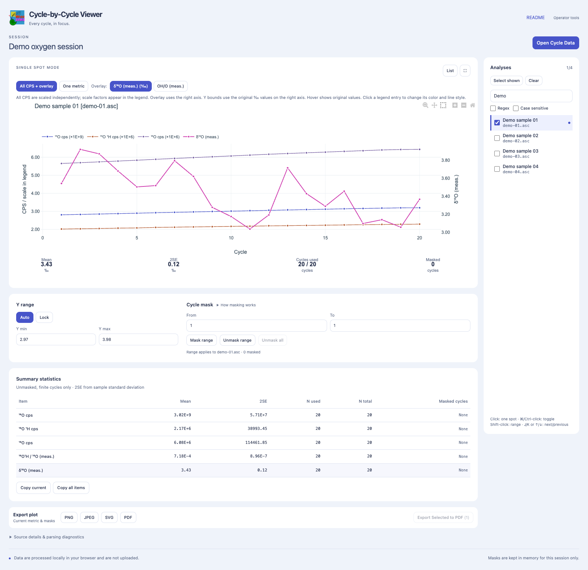
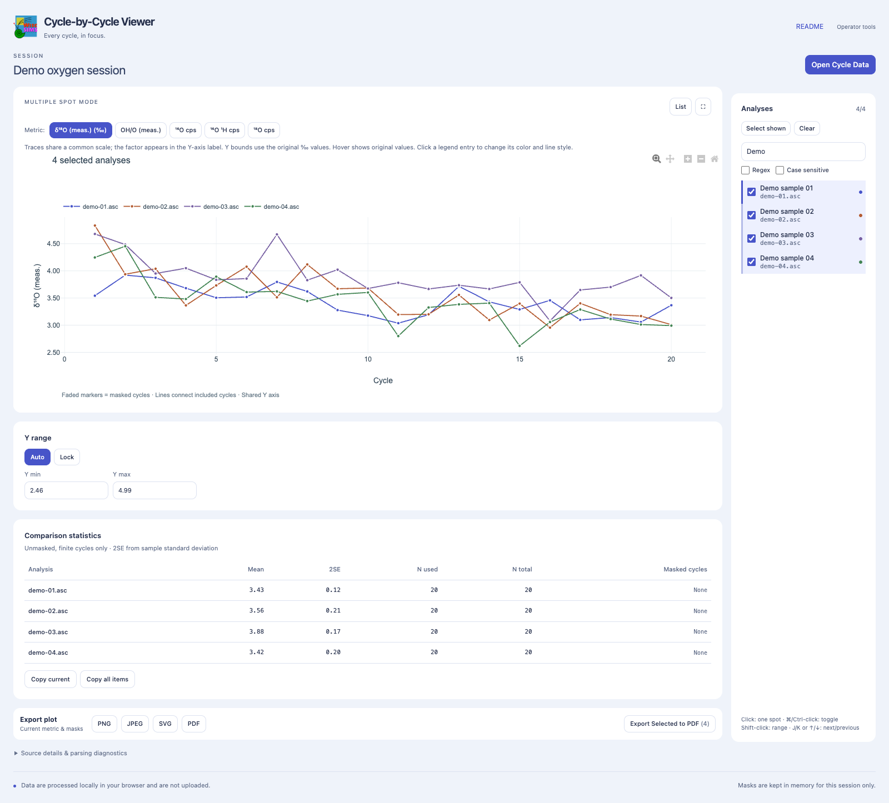
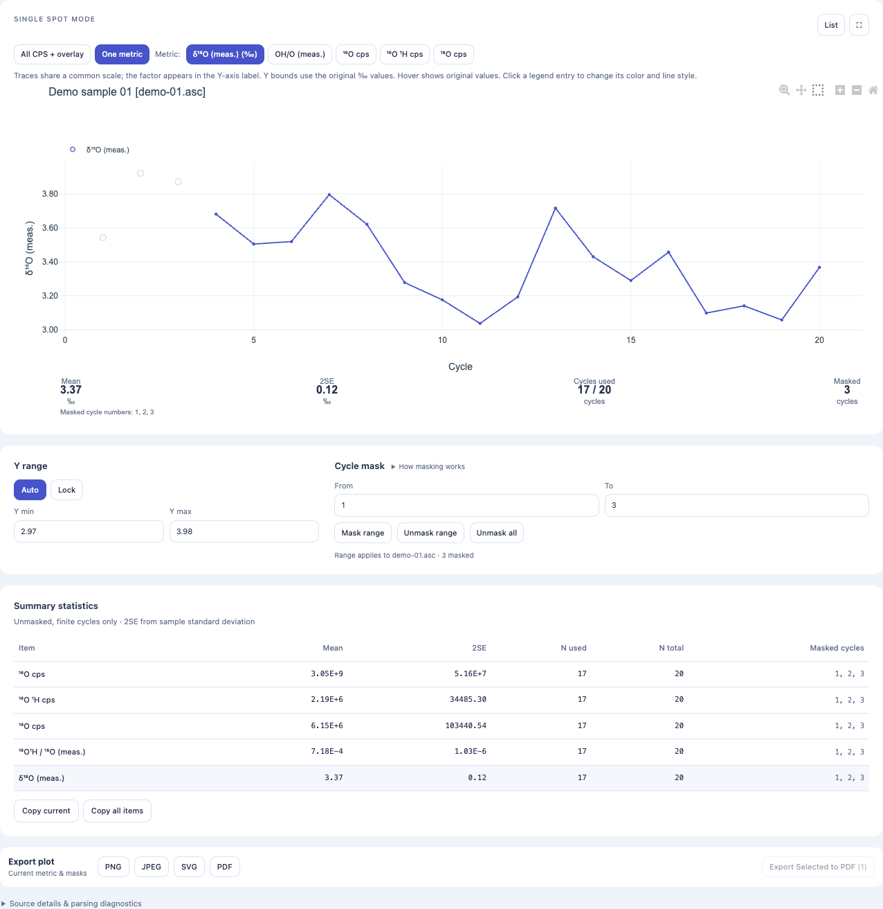

# WiscSIMS Cycle-by-Cycle Viewer

Inspect CAMECA / WiscSIMS measurements one cycle at a time. View ion intensities (CPS), measured isotope ratios, and δ values; compare spots; exclude cycles; copy summary statistics; and save plots.

**[Open the viewer](https://saburo.github.io/cycle-by-cycle-viewer-pages/)**

Use a desktop browser. No installation or account is required. Measurement files are processed in your browser and are not sent to a server. Your original files are never changed.

> **Save your results before leaving the page.** Reloading, closing the page, or opening another dataset clears the loaded data and masks. Cycle Data JSON files do not preserve masks or display settings.

## Get started

1. [Open the viewer](https://saburo.github.io/cycle-by-cycle-viewer-pages/).
2. Click **Open Cycle Data**, then **Choose file**, and select the `*_CycleData.json` file you received.
3. Click a spot in the **Analyses** list on the right.
4. Inspect the changes across cycles. Choose **One metric** to display a single measurement or calculated value.
5. If needed, mask cycles, then click **Copy current** to copy statistics or choose **PNG**, **PDF**, or another format under **Export plot** to save the figure.

This guide assumes you have received a Cycle Data JSON file from the person preparing the dataset. You do not need the original ASC or Excel files. The screenshots show measured CPS values with fictitious filenames, comments, and session names.

## Read a single spot plot

_Figure 1. Spot `demo-01.asc` (Demo sample 01), selected after searching for `Demo`. The Y range and cycle mask controls are below the plot, followed by summary statistics and export buttons._

- **All CPS + overlay** displays every CPS channel on the left axis and the selected δ value or ratio on the right axis. Each CPS channel has its own scale factor. Read the factor in the legend when comparing absolute intensities.
- **One metric** displays one CPS channel, δ value, or ratio. Choose a metric using the buttons above the plot or its name in the statistics table.
- **δ¹⁸O (meas.) (‰)** shows the measured δ¹⁸O value for each cycle.
- **OH/O (meas.)** shows the measured ¹⁶O¹H / ¹⁶O ratio. It is a dimensionless ratio, not a water concentration.

Hover over the plot to see values in their original units. **Cycle** numbers start at 1 for the first recorded row. Cycle Data files do not include the instrument's original block and cycle numbers.

Use the chart toolbar to zoom, pan, or reset the view. Mouse wheel zoom is disabled. **List** shows or hides the analysis list, and **⛶** maximizes the chart. Press **Esc** to restore it.

### Change colors and lines

1. Click the legend entry for the series you want to change, such as **¹⁶O cps**. In a comparison plot, click the entry for the relevant spot. The **Series style** dialog opens and identifies the spot and metric.
2. Choose **Color**, enter **Line width (px)** from 0.1 to 10, and select **Line style**. Available styles are solid, dashed, dotted, dash and dot, long dash, and long dash and dot. The preview and plot update immediately; there is no Apply button.
3. To return that series to its default color, width, and line style, click **Reset**. Other series keep their settings.
4. Click **Close** or press **Esc** when finished. Closing the dialog keeps your changes.

You can also use **Tab** to focus a legend entry, then press **Enter** or **Space** to open the dialog. These controls are available in both **All CPS + overlay** and **One metric**, as well as comparison plots.

Settings apply to that spot and metric, remain when switching views, and are reflected in plot exports, including **Export Selected to PDF**. They last for the current session and are not stored in Cycle Data JSON files.

### Set the Y range

Under **Y range**, **Auto** sets the range automatically, while **Lock** holds the current bounds. Editing **Y min** or **Y max** switches to Lock and applies valid bounds after a short pause.

Enter values in the original units. For example, if the axis shows `×1E+9`, enter `2.5E9` for 2.5 billion. In **All CPS + overlay**, these bounds apply to the right axis; CPS channels keep their independent scales. Invalid input leaves the last valid range in place and displays an error. Click **Auto** to release the lock.

## Compare spots

Select spots in the **Analyses** list on the right.

| Action                                                | Result                                                                                     |
| ----------------------------------------------------- | ------------------------------------------------------------------------------------------ |
| Click a row                                           | Display that spot alone                                                                    |
| Hold **⌘** (Mac) or **Ctrl** (Windows) while clicking | Add or remove a spot                                                                       |
| Click a checkbox                                      | Add or remove that spot                                                                    |
| Hold **Shift** while clicking                         | Select a continuous range in the list                                                      |
| **Select shown**                                      | Select all spots currently shown in the list                                               |
| **Clear**                                             | Remove all selections and clear the plot                                                   |
| **J / K** or **↓ / ↑**                                | Move to the next or previous spot when the list has focus and exactly one spot is selected |

**Filter analyses…** searches filenames, sample names, and comments by substring. Cycle Data files do not include original sample names, so use filenames or comments to find spots. Enable **Regex** for regular expressions or **Case sensitive** to distinguish uppercase and lowercase letters.

> Spots hidden by a filter remain selected. To compare only the search results, click **Clear**, enter your search, then click **Select shown**.

_Figure 2. Spots `demo-01.asc` through `demo-04.asc` compared on a common δ¹⁸O scale. The table below shows each spot's mean, 2SE, and cycle count._

With multiple spots selected, use the metric buttons to choose what to compare. All traces share a common scale. Masks cannot be edited in this view. To change a mask, select the relevant spot alone, edit its mask, then select the comparison spots again.

## Mask cycles

Masking excludes cycles from plotted lines and summary calculations. It is available when one spot is selected.

1. Select a single spot.
2. Click inside the plot to toggle the horizontally nearest recorded cycle. Drag a box around several points to toggle each selected cycle between included and masked.
3. To specify cycle numbers, enter **From** and **To** under **Cycle mask**, then click **Mask range**. Both endpoints are included.
4. Use **Unmask range** to restore the specified range or **Unmask all** to restore every cycle for that spot.

After using zoom or pan, choose **Drag mask / unmask** in the chart toolbar to return to box selection.

_Figure 3. Cycles 1 through 3 of Demo sample 01 are masked to demonstrate the controls. This example does not imply that those cycles should be excluded from an analysis. Masked points remain faintly visible, and the statistics and cycle count update._

A spot's mask applies to every CPS channel, ratio, and δ value. Lines connect the included cycles on either side of masked points. Genuine missing values break the line. Masks last only for the current page session.

## Read and copy statistics

| Column            | Meaning                                                     |
| ----------------- | ----------------------------------------------------------- |
| **Mean**          | Arithmetic mean of the included, finite cycle values        |
| **2SE**           | `2 × SD / √N`, using the sample standard deviation          |
| **N used**        | Number of cycles used to calculate that metric's statistics |
| **N total**       | Total number of recorded cycles                             |
| **Masked cycles** | Excluded cycle numbers, or `None`                           |

Missing and nonfinite values are excluded. A smaller **N used** can reflect missing values as well as masks. Mean is `N/A` when no valid values remain; 2SE is `N/A` when fewer than two remain.

**Copy current** copies the current metric's statistics for the displayed spots. **Copy all items** copies statistics for every available metric for those spots. It does not select every spot in the dataset. The output is tab separated, so you can paste it into Excel or another spreadsheet.

Values on screen are rounded for readability. Copied numbers retain full precision. If clipboard access is unavailable, a text box appears so you can select and copy its contents manually.

## Save plots and results

| Action                            | Output                                                                  | Use                                                                                           |
| --------------------------------- | ----------------------------------------------------------------------- | --------------------------------------------------------------------------------------------- |
| **PNG / JPEG / SVG / PDF**        | The current plot, including the selected metric and masks               | Figures for reports or presentations                                                          |
| **Export Selected to PDF**        | One selected spot per page, in natural list order                       | Review multiple spots using the same metric and Y range; requires at least two selected spots |
| **Copy current / Copy all items** | Statistics reflecting the current masks, including masked cycle numbers | Record results in a spreadsheet                                                               |

**Reopening a Cycle Data file starts with every cycle included.** It does not restore your masks or display settings. Save plots and copy statistics separately to keep a record of your results and excluded cycle numbers.

## Understand the values

- **CPS** values come from the ASC report's `CORRECTED DATA` table. They are count rates already corrected by the instrument. The viewer applies no additional detector corrections.
- **δ¹⁸O (meas.)** is calculated for each cycle as `((¹⁸O / ¹⁶O) / 0.0020052 − 1) × 1000`.
- **δ¹³C (meas.)** is calculated as `((¹³C / ¹²C) / 0.0111802 − 1) × 1000`. The carbon hydride ratio uses the available ¹²C¹H or ¹³C¹H channel as its numerator; the label identifies the channel used.
- **Measured δ values have no additional calibration against reference materials.** Their reported mean is the arithmetic mean of cycle δ values and can differ from an integrated instrument ratio or a final reported result.

The viewer accepts Cycle Data V2 files. Carbon calculations have been checked numerically and with a synthetic ASC report; validation of the actual carbon ASC report format remains incomplete.

## Troubleshooting

| Problem                                  | What to do                                                                                                                                    |
| ---------------------------------------- | --------------------------------------------------------------------------------------------------------------------------------------------- |
| The plot is empty                        | Select a spot after using **Clear**. Clear the search field if the spot is hidden                                                             |
| Lines remain after filtering             | Hidden selections are still active. Click **Clear**, enter the search, then **Select shown**                                                  |
| Mask controls are unavailable            | Select exactly one spot. For box selection, choose **Drag mask / unmask**                                                                     |
| A JSON file will not open                | Check that it is a Cycle Data V2 file exported by this viewer. Ask the person preparing the dataset for a new file if it uses an older format |
| Masks disappear after reopening the file | Masks are held only for the page session. Save plots and statistics, then reapply recorded cycle exclusions when needed                       |

If comments or measurement channels are unexpected, contact the person who prepared your dataset.
